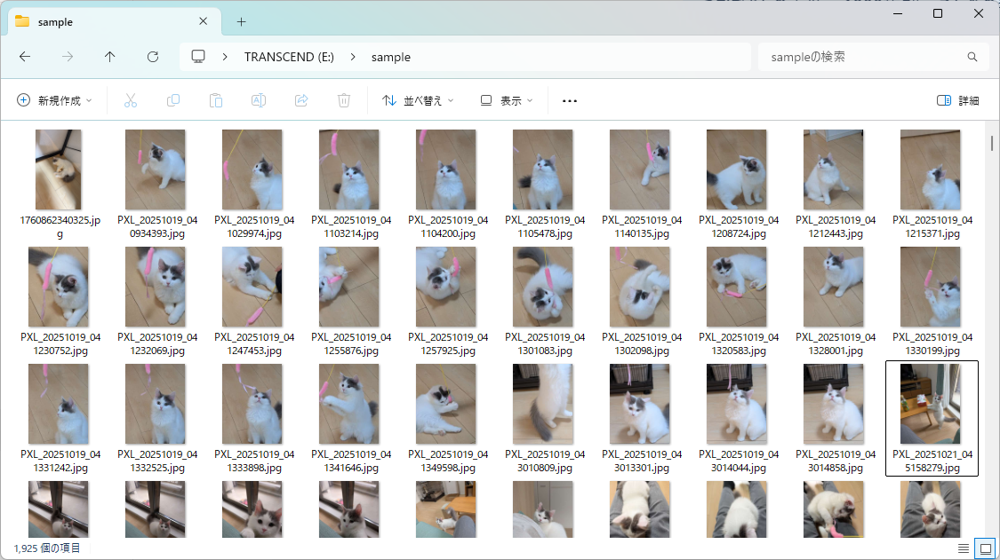
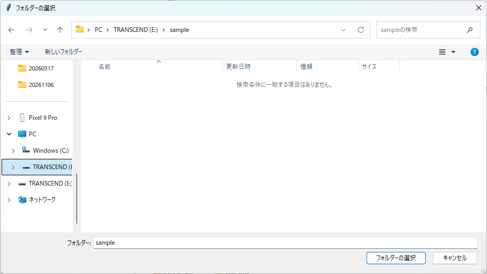
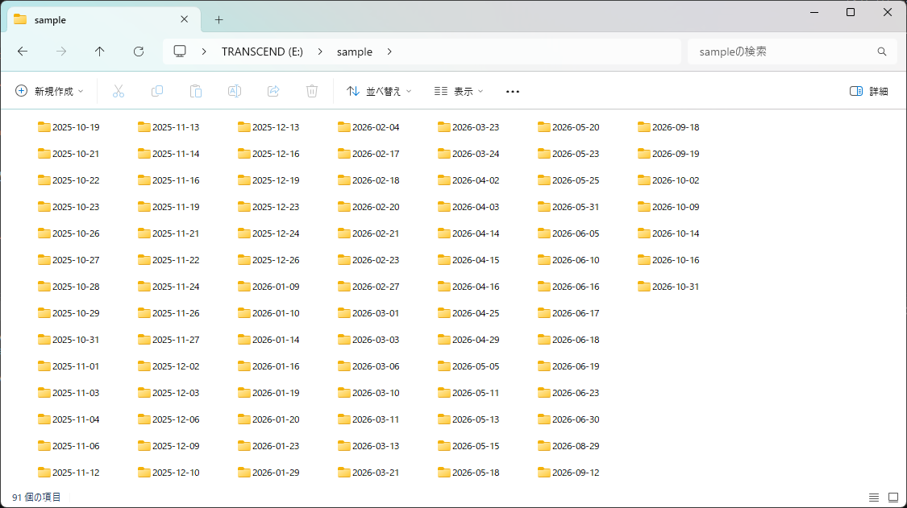
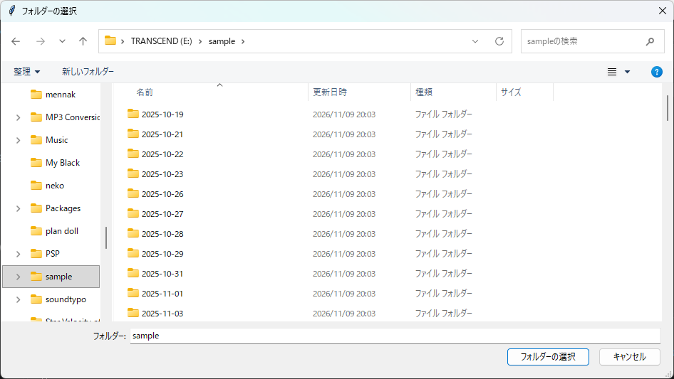
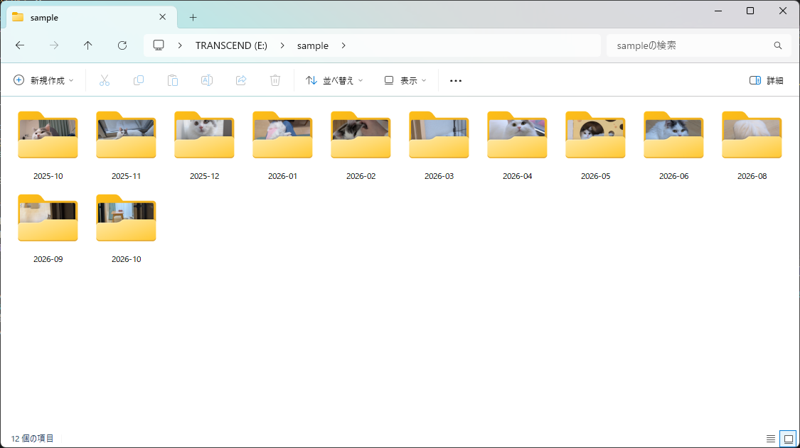

# 日付別/月別画像整理ツール
フォルダ内の画像ファイル(.png, .jpg)を、日付別/月別のフォルダに整理するツールです。 \
ゲームのスクリーンショットを整理したくて作りました。

## 使い方
1. `daily_sorter.py`を実行し、整理したいフォルダを選択

フォルダを選択

日付別に整理！

2. 月別に整理したい場合はさらに`monthly_sorter.py`を実行し、先ほど選択したフォルダを再度選択

月別に整理！

## 今後の予定（やりたいこと）
- フォルダ構成の自動判別
- 日付別、月別、未整理状態の自動認識
- 月別ソート単体での実行対応

ご覧いただきありがとうございます！
